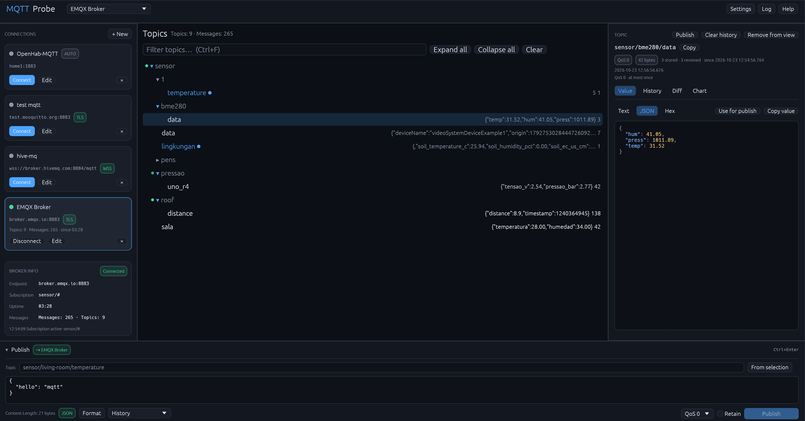

# MQTT Probe

**Explore, analyze, and manage your MQTT brokers with speed and elegance.**

**MQTT Probe** is a modern, native desktop application built in Rust. Inspired by [MQTT Explorer](https://github.com/thomasnordquist/MQTT-Explorer), it combines a **GPU-accelerated interface** with **deep payload inspection tools**, making MQTT debugging smoother, faster, and more intuitive than ever. Ready-to-use binaries are available for both **Linux and Windows**!

---



---

## Key Features

| Feature Category | Highlights & Capabilities |
| --- | --- |
| **⚡ Performance & Core** | Built with Rust and egui for an ultra-responsive, GPU-accelerated interface that handles heavy message traffic effortlessly. |
| **🌳 Smart Topic Tree** | Hierarchical display with animated message flows, search, payload filters, and persistent tree snapshots between runs. |
| **📊 Payload Analysis** | Line-by-line diff view, interactive real-time charts for numeric and nested JSON payloads, and clean syntax highlighting. |
| **🛡️ Security & Transports** | Full support for plain TCP, TLS, Mutual TLS (mTLS), standard WebSockets (`ws`), and Secure WebSockets (`wss`) with custom CA support. |
| **💬 Publish & Retained Management** | Feature-rich publish composer with QoS 0–2, retain flag, history, and protocol-compliant deletion of retained messages. |
| **🌐 Localization & UI** | Fully localized in **6 languages** (English, German, French, Korean, Chinese, and Spanish) with smooth dark/light themes and live connection diagnostics. |

---

## 🛠️ Installation & Quick Start

### **Ready-to-Use Binaries**

Pre-compiled binaries for **Linux and Windows** are available on the [Releases page](https://github.com/klumw/mqtt-probe/releases) for quick, out-of-the-box usage.

### **Building from Source**

If you prefer to build it yourself:

* **Prerequisites:** Rust 1.95+ (2024 edition). Linux users may need basic build and windowing dependencies:
```bash
sudo apt install build-essential pkg-config libxkbcommon-dev libwayland-dev

```

* **Run:**
```bash
cargo run --release

```

### **Debian / Ubuntu Package**

Build a native `.deb` package and install it with `apt`:

```bash
./packaging/build-deb.sh
sudo apt install ./dist/mqtt-probe_*.deb
```

The package installs the binary to `/usr/bin/mqtt-probe`, the launcher to `/usr/share/applications/mqtt-probe.desktop`, the icon set to `/usr/share/icons/hicolor`, and AppStream metadata (license and app details for software centers) to `/usr/share/metainfo/mqtt-probe.metainfo.xml`.

---

## ⌨️ Keyboard Shortcuts

| Shortcut | Action |
| --- | --- |
| `Ctrl + F` | Focus topic search |
| `Ctrl + Enter` | Publish payload |
| `Esc` | Reset filters |
| `Ctrl + Q` | Save state and quit |

---

## 📄 License

This project is licensed under the [Apache License, Version 2.0](LICENSE).
